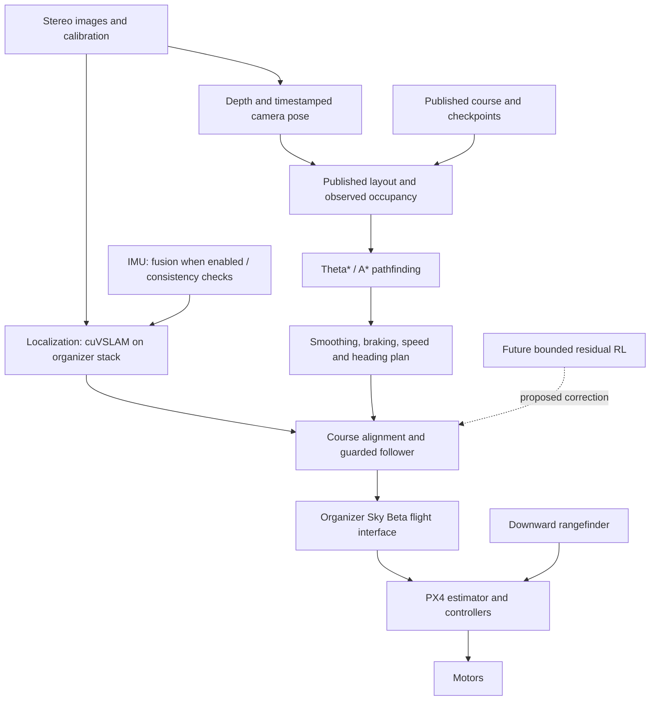

# DroneHacks2026

Autonomous indoor obstacle-course flight for **Sky Beta**: reliable localization,
collision-aware pathfinding, smooth motion and supervised execution. We start
with a repeatable classical baseline, improve speed, then evaluate bounded
residual reinforcement learning.

This repository combines the team's online planner and flight programs with our
Gazebo/PX4 benchmarks, localization experiments, tests and plans.
**Simulation results are not hardware qualification.**

## The challenge

Program the supplied drone to take off, traverse the indoor course in the required
order, pass the selected openings and land on the destination pad. Flying over
the walls does not count as completing the outbound obstacle route. Reliability
comes first; speed matters once a valid finish is repeatable.

The supplied brief describes a 180-second run limit, checkpoint and timing points,
an optional window bonus and a return-to-start bonus after landing. There is no
separate package-delivery task in that brief. The official event amendments remain
authoritative; see [challenge notes](docs/CHALLENGE.md).

**Five scored checkpoint groups and nine diagnostic gate planes are different
counts.** The nine-plane simulation audit subdivides the route geometry; it does
not replace the competition scoring system.

## Hardware and runtime

| Component | Role |
|---|---|
| Jetson Orin Nano 8 GB | Runs ROS 2 perception and autonomy |
| Pixhawk 6C / PX4 | State estimation, stabilization and motor control |
| OAK-D S2 | Stereo images, depth and camera-side processing |
| Downward VL53L1X | Height above the floor |
| Estimated Sky Beta simulation model | CAD-derived geometry/inertia; explicit estimates for missing propulsion data |

The original brief mentioned ROS 2 Humble. The GB10 benchmark uses ROS 2 Jazzy,
Gazebo Harmonic and PX4 v1.16 SITL. Deployment must match the actual organizer
image, message versions, CUDA environment and measured camera calibration.

## Proposed solution



### 1. Localization: where are we?

Images track recognizable details as the camera moves. Stereo helps estimate
depth; inertial measurements can support motion estimation when fusion is enabled.
Timing, camera calibration and camera-to-body transforms are essential.

- **OpenVINS stereo-inertial:** estimator behind the successful native Gazebo/PX4
  benchmark flights.
- **cuVSLAM:** organizer-compatible estimator under evaluation. The inspected
  Sky Beta image uses **stereo-only tracking, IMU fusion off and loop closure
  disabled**. Our experimental wrapper also supports inertial comparisons; this
  configuration has not become a successful course baseline.
- **Course anchoring:** aligns startup odometry with the known course launch pose.
  This is separate from motion estimation and pathfinding.

Continuous local odometry feeds control. Future map/loop-closure corrections need
explicit handling to avoid sudden control targets. Replacing an estimator requires
rechecking frames, timestamps, uncertainty, reset handling and health diagnostics.

### 2. Mapping: what space is safe?

Initialize a map from the published layout, then update local occupancy using
depth images and their measurement-time camera poses. Keep unknown space distinct
from free space. Reserve clearance for the complete aircraft, estimation error
and tracking error.

The team planner implements published-map plus depth updates. Separate
`dronebench` modules explore voxel mapping, stereo ambiguity rejection, wall
constraints and drift diagnosis; these are not all flight-integrated. Repeating
net patterns can produce plausible but incorrect stereo matches.

### 3. Pathfinding: which route?

- **Team online planner:** Theta* by default, with A* available. Any-angle Theta*
  avoids unnecessary grid stair-steps, replans when the depth-updated map changes,
  and sequences checkpoint groups. See [team/pathfinding](team/pathfinding/README.md).
- **Native benchmark baseline:** published-map A*, checked shortcuts and Bezier
  corner construction, followed by clearance and gate audits.
- **Corridor prototype:** elastic-band optimization using signed-distance
  clearance and cubic-spline smoothing. This is an offline candidate, not a
  completed minimum-snap optimizer.

The published-layout baseline alone cannot account for unexpected obstacles.
Depth-aware replanning and robust localization must work together.

### 4. Trajectory generation: how fast, and facing where?

Assign speed, acceleration and heading along the route. Brake before tight turns,
accelerate on open straights, limit lateral acceleration and yaw rate, and retain
useful camera views.

The native baseline uses smoothing, perception-aware heading selection and
forward/backward speed passes. Older references also bound jerk. It does **not**
explicitly minimize snap. Corridor-constrained minimum-snap/minimum-time
trajectories are proposed comparisons, not measured improvements.

### 5. Execution: follow the plan

A moving reference slows when the aircraft falls behind or drifts from the path.
The follower preserves estimator, telemetry freshness, authority and clearance
checks. Short look-ahead position targets support the organizer interface.

| Target | Our code publishes | Control ownership |
|---|---|---|
| Organizer Sky Beta | `/skybeta/setpoint/pose` or approved twist targets; reads `/visual_slam/tracking/odometry` and `/skybeta/state` | Organizer interface owns PX4; safety pilot arms and can take over |
| Native Gazebo/PX4 and labeled FlyX scripts | `/fmu/in/*`, native Offboard/setpoint commands | Reviewed simulator-only mission supervisor |

Do not run a native `/fmu/in/*` controller alongside the organizer interface.
Some organizer-facing programs finish by holding over the pad for pilot landing;
that is not autonomous landing. Native benchmark velocity/acceleration feedforward
is not available through every organizer interface, so timings do not transfer
automatically.

### 6. Residual RL and VLA research

After a reliable integrated baseline, train a small policy to make bounded
corrections around the classical planner/follower. Vary dynamics, sensor
delay/noise, appearance and obstacles during training. Deployed observations must
come from actual sensors/estimators; simulator truth stays outside flight
algorithms and is used separately for training support and evaluation.

Residual RL is **proposed, not a demonstrated flight improvement** here. VLA
experiments are offline research. The measured OpenFly 7B BF16 configuration
exceeds the Orin Nano's memory budget, and its macro actions need a separately
validated motion adapter.

### 7. Recording, replay and evaluation

`team/path_recorder` records pilot-flown odometry without publishing flight
commands. `team/path_player` can replay that recording relative to a new launch
frame through the Sky Beta interface. Replay is a separate experiment, not
general obstacle avoidance; check the competition's cross-run data restrictions.

For autonomous benchmarks, retain a mission journal, native telemetry, source
timestamps and observer/onboard video. Independently audit ordered gate crossings,
the aircraft envelope, contacts and destination landing/disarm. Preserve failed
runs and distinguish simulation time from wall time and nominal reference time.

## Recorded results

| Evidence | Outcome | Timing and limits |
|---|---|---|
| Native Gazebo v83 / OpenVINS | Takeoff, 9/9 audited gates, pad landing/disarm; zero sampled structure contacts | **113.85 s simulated arm-to-disarm**; one completion in three same-batch attempts |
| Native Gazebo v55 / OpenVINS | Same full outbound sequence; zero sampled structure contacts | **119.56 s simulated arm-to-disarm**; earlier milestone |
| Native Gazebo v117 / OpenVINS | Full outbound completion, 9/9 gates | **123.84 s simulated arm-to-disarm**; different conservative speed profile |
| Team FlyX v4c / 2026-11-08 | Reported 5/5 checkpoint groups and destination landing | **136.2 s reported arm-to-disarm**; separate lab/journal clock |
| Organizer-profile cuVSLAM v107/v118 | Took off, tracking/consistency fault, landed | **No course completion**; inertial integration unresolved |

Native runs use estimated appearance/dynamics. Selected original reports,
evaluations and hashes are in [benchmarks](benchmarks/README.md). Raw images,
bags, weights, ULogs and videos remain in ignored local storage and are not
downloaded with this repository. Historical video paths are not hosted links.

## Repository map

| Path | Purpose |
|---|---|
| [`team/`](team/README.md) | Provenance-recorded teammate planner, flight programs, recorder and Jetson tools |
| [`team/pathfinding/`](team/pathfinding/README.md) | Theta*/A*, depth belief, tests and offline harness |
| `team/team_ws/src/pathfinding/` | Self-contained ROS 2 planner package |
| [`flight_programs/`](flight_programs/README.md) | Local standalone programs, generated files and candidates |
| `dronebench/` | Planning, geometry, mapping, mission, telemetry and estimation helpers |
| `tools/` | Reference generators, ROS adapters, audits, analysis and recording |
| [`sim/`](sim/README.md) | Gazebo/PX4 integration, estimated airframe and MuJoCo preview |
| `configs/`, `examples/` | Explicit settings and synthetic offline inputs |
| `tests/` | Offline regressions and local-artifact integration checks |
| `dronehacks-course-v3-obj/` | Supplied course OBJ/MTL used by geometry tests/builders |
| [`docs/`](docs/README.md) | Setup, architecture, challenge, validation and historical plans |

Local working copies, CAD, recordings and archives remain intact and ignored.
Upstream headers and provenance are preserved; see [attribution](docs/THIRD_PARTY.md).

## Quick start: offline development

Python **3.10+**. Linux/WSL is required for ROS/Gazebo. These commands do not arm:

```bash
python -m venv .venv
source .venv/bin/activate                 # Windows: .venv\Scripts\Activate.ps1
python -m pip install -r requirements-dev.txt
python -m pytest tests -q
python -m ruff check dronebench tools sim tests
python -m dronebench strategies
python -m dronebench profile examples/synthetic_path.json --output artifacts/example-profile.json
```

Outputs are exclusive-created: use a new path for each retry. Local-artifact
integration tests need saved experiment inputs. See [validation](docs/VALIDATION.md).

Test the team planner in its own import context:

```bash
cd team/pathfinding
python -m pytest tests -q
# Optional kinematic/depth benchmark, not a PX4 flight:
python -m pathplan.harness --help
```

Build a static course scene without launching an aircraft:

```bash
python tools/build_course.py --source dronehacks-course-v3-obj --output artifacts/course-preview
```

MuJoCo is an optional lightweight preview using `requirements-sim.txt`. A scene
preview is not a flown course benchmark.

## Simulation and deployment

Read [setup and reproduction](docs/REPRODUCING.md), then the
[runtime documentation](sim/runtime/README.md). Historical GB10 scripts expect
prepared scenes, runtime workspaces and references: cloning alone does not
reconstruct every recorded experiment. Installation, tests and CI launch no flight.

For organizer-facing development, inspect the current image and build the package
under `team/team_ws/src/pathfinding/`. Pip requirements do not install ROS, PX4,
CUDA or cuVSLAM. Keep organizer software and parameters under organizer control.

Before flight: get team approval for the concrete plan, inspect fresh telemetry,
confirm the estimator/control owner and preserve pilot takeover. After keyboard
RC in the managed lab, land, release RC and use **Reset world** before automation.
Read [AGENTS.md](AGENTS.md) and current organizer instructions.

## Remaining work

1. Establish repeatable organizer-interface completion with calibrated cuVSLAM and
   measured latency; native OpenVINS timings are a separate baseline.
2. Validate depth updates and course alignment through netting, narrow openings
   and low-texture turns.
3. Improve trackability: consistent reference derivatives, braking, camera heading
   and measured uncertainty/clearance budgets.
4. Compare corridor/minimum-snap candidates with repeated full flights, unchanged
   independent audits, recordings and source-clock timing.
5. Qualify autonomous landing and the return bonus through the actual interface.
6. Evaluate bounded residual RL, target-computer performance and hardware transfer.
